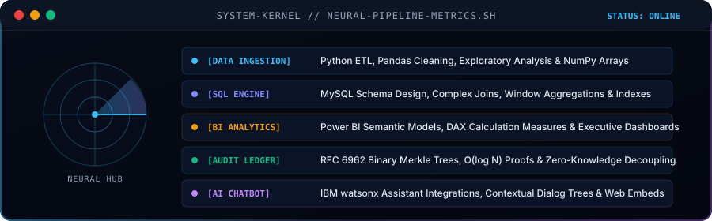

<!-- AI Cinematic Motion Header Banner -->

 

[;Data+Analyst+%7C+Power+BI+%26+DAX;Relational+Database+Architect;AI+%26+Data+Engineering+Enthusiast)](https://github.com/Anilkumar4516)

  📍 <strong>Andhra Pradesh, India</strong> &nbsp;•&nbsp; 🎓 <strong>B.E. Computer Science & Engineering (2025)</strong> &nbsp;•&nbsp; 💼 <strong>Ex-Algonex IT Solutions Intern</strong>

---

## ⚡ Neural Core Architecture & Capabilities

  

---

## 👨‍💻 About Me

I am a Computer Science graduate specializing in **relational database systems**, **Python data processing pipelines**, and **analytical business intelligence**. My engineering focus is on turning ambiguous, complex data requirements into robust relational schemas, optimized SQL queries, and interactive visual dashboards.

- 💼 **SQL with Python Developer Intern** at Algonex IT Solutions (2026) — wrote complex relational queries, data extraction pipelines, and Python transformation scripts.
- ☁️ **Data Engineering Virtual Intern** supported by AWS Academy (AICTE-EduSkills, 2023) — cloud storage, pipeline architecture, and distributed data fundamentals on AWS.
- 🎯 Seeking **Software Engineer** (Python, SQL, data) and **Data Analyst** opportunities.

---

## 🛠️ Technical Stack & Frameworks

  
  
  
  
  
  
  

- **Databases & Querying:** SQL, MySQL, Relational Schema Design, Multi-Table Joins, Window Functions, Aggregations, Subqueries
- **Programming & Scripting:** Python (Pandas, NumPy, Matplotlib), Node.js / JavaScript basics
- **Business Intelligence & Analytics:** Power BI (Power Query, DAX, Semantic Data Modeling, Report UX), Microsoft Excel (Pivot Tables, Lookups)
- **AI & Cloud Platforms:** IBM watsonx Assistant, IBM Watson Studio, AWS cloud fundamentals
- **Version Control & Tools:** Git, GitHub, VS Code, Jupyter Notebook

---

## 🚀 Featured Engineering Projects

| Repository | Tech Stack | Highlights & Architecture |
| :--- | :--- | :--- |
| [**vote-genz-wallet**](https://github.com/Anilkumar4516/vote-genz-wallet) | Node.js, Express, SQLite / PostgreSQL, Redis | Voting platform prototype featuring an RFC 6962 Merkle tree audit ledger with $O(\log N)$ inclusion proofs and decoupled voter-ballot secrecy. |
| [**ai-sql-analytics-assistant**](https://github.com/Anilkumar4516/ai-sql-analytics-assistant) | Python, SQL, LLM Prompting | Assistant designed to translate natural language business questions into structured, executable SQL queries and analytics insights. |
| [**ibm_website**](https://github.com/Anilkumar4516/ibm_website) | HTML5, CSS3, Bootstrap 5.3, watsonx Assistant | Personal portfolio showcasing software projects, core competencies, an interactive AI neural canvas, and an embedded live IBM watsonx Assistant chatbot. |
| [**Ibm_project**](https://github.com/Anilkumar4516/Ibm_project) | Python, Pandas, Plotly | Milestone presentations for an applied data science project predicting sales revenues based on advertising channels (TV, Radio, Newspaper). |
| [**IBM-_Street-Food**](https://github.com/Anilkumar4516/IBM-_Street-Food) | HTML5, JavaScript, watsonx Assistant | Web landing page demonstrating conversational assistant integration using an embedded IBM watsonx Assistant web-chat widget. |

---

## 📊 Live GitHub Analytics

  
  

---

## 📜 Certifications & Credentials

- **Microsoft Learn:** Prepare and Visualize Data with Microsoft Power BI (Oct 2026) — 12 modules covering DAX, semantic models, and report UX.
- **Kaggle:** Python Coder Badge (Oct 2026) — Python data structures, functions, and working with external libraries.
- **IBM Career Education:** IBM Watson Studio (Aug 2024).
- **AICTE - EduSkills & AWS Academy:** Certificate of Virtual Internship in Data Engineering (Nov 2023).
- **CareerNinja / LearnTube:** Data Analytics Certification (Mar 2024).

---

## 📫 Get in Touch

- **Email:** [anilkumarbadipati4362@gmail.com](mailto:anilkumarbadipati4362@gmail.com)
- **GitHub:** [github.com/Anilkumar4516](https://github.com/Anilkumar4516)
<!-- - **LinkedIn:** [linkedin.com/in/YOUR-PROFILE](https://linkedin.com/in/YOUR-PROFILE) -->
